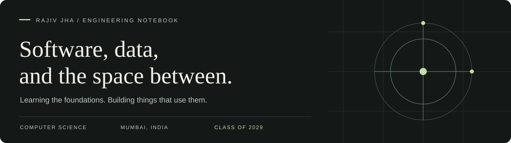
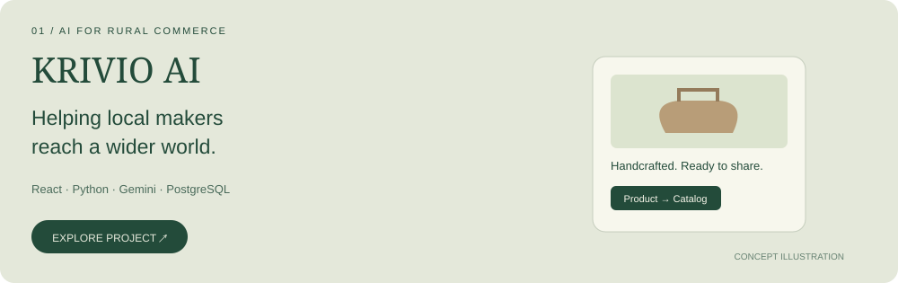
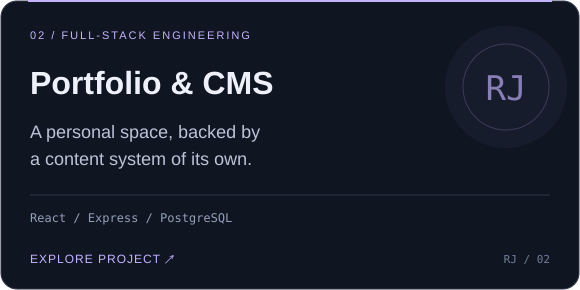
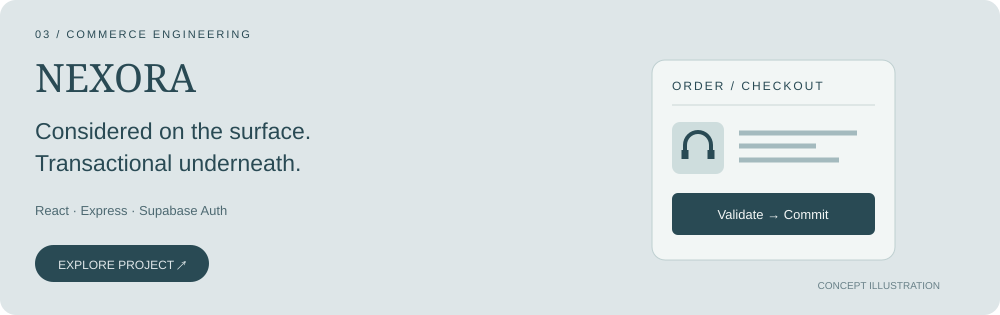
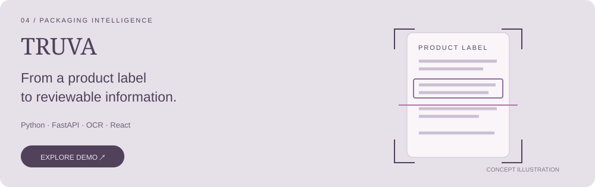

<!-- Repository-owned SVG artwork. Header animation includes reduced-motion support. -->

<a href="https://portfolio-beta-ochre-90.vercel.app/"><b>PORTFOLIO ↗</b></a> &nbsp;&nbsp; / &nbsp;&nbsp;
<a href="https://www.linkedin.com/in/rajiv-jha-9b36ba3a2/"><b>LINKEDIN ↗</b></a> &nbsp;&nbsp; / &nbsp;&nbsp;
<a href="https://leetcode.com/u/Rajiv_Jha/"><b>LEETCODE ↗</b></a> &nbsp;&nbsp; / &nbsp;&nbsp;
<a href="mailto:jharajiv315@gmail.com"><b>EMAIL ↗</b></a>

 

### A builder's mindset. A student's curiosity.

I'm a computer science student at **SLRTCE, Mumbai**, working toward **AI/ML engineering**. I build web applications, explore data with Python, and practise problem solving in Java.

I'm interested in how the pieces connect: the data, the model, the backend, and the interface someone actually uses. My projects are where I work through those connections—and discover what I still need to learn.

<a href="#selected-work">Explore my work ↓</a> &nbsp; · &nbsp; <a href="#currently">What I'm learning ↓</a> &nbsp; · &nbsp; <a href="#toolkit">My toolkit ↓</a>

 

## Selected work
Personal builds and team projects. Click a card to explore; expand the notes for context.

 

<b>What we're building ↴</b>

A team project exploring digital-commerce tools for artisans, farmers, and self-help groups. Voice assistance in Indian languages, product-image workflows, catalog exports, and shareable storefronts bring the experience together.

**Stack:** React · TypeScript · FastAPI · PostgreSQL · Gemini

[Source and architecture →](https://github.com/jharajiv315/KRIVIO-AI)

 

<b>Behind the interface ↴</b>

A public portfolio with a separate admin dashboard for projects, skills, and timeline entries. Content updates flow through the API, so they don't require editing the frontend source.

**Engineering focus:** protected administrative workflows, API integration, and media management.

[Visit portfolio →](https://portfolio-beta-ochre-90.vercel.app/) · [Read the code →](https://github.com/jharajiv315/Portfolio)

 

<b>What happens at checkout ↴</b>

Built during my CodeAlpha internship. Beyond browsing and cart interactions, the backend calculates order totals and uses database transactions with row locking for stock updates.

**Stack:** React · TypeScript · Express · PostgreSQL · Supabase Auth

[Explore the implementation →](https://github.com/jharajiv315/CodeAlpha_EcommerceStore)

 

<b>The problem and my contribution ↴</b>

A team project exploring packaging-text extraction and rule-based checks for inspectors and consumers. My focus is **machine learning and backend development**, connecting extracted information to results people can review.

**Stack:** Python · FastAPI · OCR · React · TypeScript

[Open demo →](https://truva-gules.vercel.app/) · Source repository is currently private.

 

## Currently, at my desk

| Focus | In practice |
| :--- | :--- |
| **Learning ML** | CampusX, exploratory analysis, preprocessing, feature engineering, and model evaluation. |
| **Solving problems** | DSA in Java, comparing approaches, understanding complexity, and testing edge cases. |
| **Building systems** | SQL, API design, and connecting application layers. |

<b>Open my experiment notes / Sonar classification ↴</b>

I've been comparing scaling, power transformations, and outlier capping for rock-versus-mine classification.

The next step is cross-validation: checking whether apparent improvements hold up beyond a single train/test split. I'm learning to ask why a result changes and whether the evaluation supports the conclusion.

 

## My working toolkit

**Languages** &nbsp; Python · Java · JavaScript · TypeScript · SQL  
**Data & ML** &nbsp; NumPy · Pandas · Matplotlib · scikit-learn  
**Applications** &nbsp; React · Node.js · Express · FastAPI · Tailwind CSS  
**Storage & workflow** &nbsp; PostgreSQL · MongoDB · Git · GitHub · Vercel

Tools I've used across learning and projects. I'm still building depth; deep learning and MLOps are future directions.

 

<b>Beyond the projects / coding practice & learning habits ↴</b>

 

[LeetCode profile →](https://leetcode.com/u/Rajiv_Jha/) · [Public repositories →](https://github.com/jharajiv315?tab=repositories)

I start with a baseline, use errors to find gaps, and revisit projects after the demo. The debugging and maintenance work matter as much as getting the first version running.

The activity card is provided by a third-party service.

 

---

 
<b>Something interesting in mind?</b> 
I'm happy to talk about projects, exchange ideas, and learn alongside other builders.
  
<a href="https://www.linkedin.com/in/rajiv-jha-9b36ba3a2/"><b>Start a conversation ↗</b></a> &nbsp; · &nbsp; <a href="mailto:jharajiv315@gmail.com">Send an email</a>
  
RAJIV JHA &nbsp; / &nbsp; BUILT WITH CURIOSITY. IMPROVED WITH PRACTICE.

